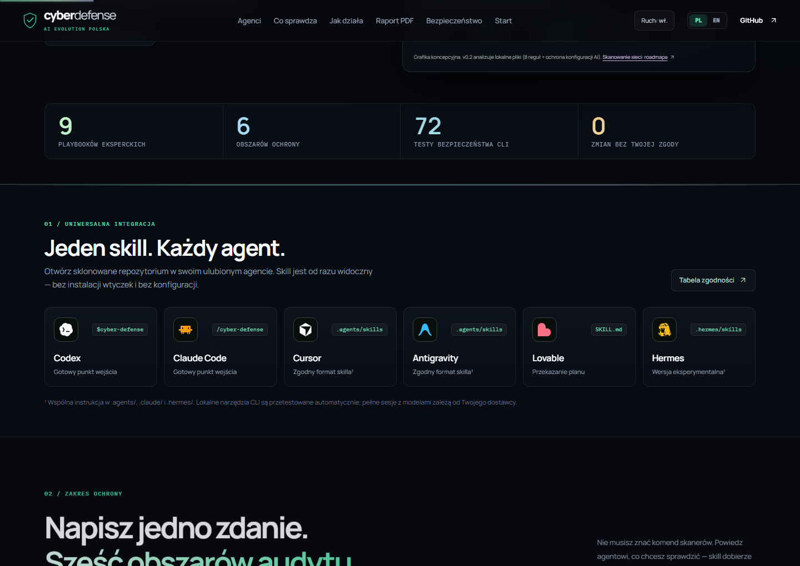

<p align="center">
  
</p>

<h1 align="center">🛡️ Cyber Defense Agent (v0.2)</h1>
<p align="center">
  <strong>Zamień swojego agenta AI w eksperta bezpieczeństwa.</strong><br/>
  Twój kod, komputer, strona WWW, baza danych i sieć. Znajdź luki z dowodem, zrozum ryzyko i zweryfikuj poprawkę.<br/>
  <em>Polskie narzędzie open-source stworzone i rozwijane przez <a href="https://github.com/aievolutionpl"><strong>AI Evolution Polska</strong></a>.</em>
</p>

<p align="center">
  <a href="https://aievolutionpl.github.io/cyber-defense-agent/"></a>
</p>

<p align="center">
  🇵🇱 <strong>Polski (Domyślny)</strong> ·
  <a href="#english-documentation">🇬🇧 Read in English</a> ·
  <a href="#szybki-start-w-60-sekund">🚀 Szybki start</a> ·
  <a href="https://aievolutionpl.github.io/cyber-defense-agent/">🌐 Strona PL</a> ·
  <a href="https://aievolutionpl.github.io/cyber-defense-agent/en/">🌐 Website EN</a> ·
  <a href="examples/sample-audit-report-pl.pdf">📄 Przykładowy raport PDF (PL)</a>
</p>

---

## 💡 O co chodzi w 30 sekund?

Modele językowe wiedzą dużo o cyberbezpieczeństwie, ale bez odpowiedniej metody zgadują wersje pakietów, zasypują setkami fałszywych alertów albo uruchamiają komendy bez pytania.

**Cyber Defense Agent** to otwarty, w pełni przejrzysty **skill oraz lokalny zestaw narzędzi CLI (Node.js 22+, zero zewnętrznych zależności npm)**, który daje Twojemu agentowi AI twardą metodę pracy:

1. **Najpierw pyta o zgodę i wyznacza zakres (`Scope Gate`)** — agent czyta wyłącznie te pliki, które jawnie zatwierdzisz.
2. **Zbiera twarde dowody zamiast domysłów** — sprawdza aktualne bazy podatności (**OSV.dev** oraz listę aktywnie wykorzystywanych luk **CISA KEV**), nagłówki HTTP/TLS, pliki lockfile i reguły kodu.
3. **Generuje wizualny raport HTML i PDF** — zanim cokolwiek zmienisz, otrzymujesz czytelny raport z werdyktem, priorytetami `P0–P3`, zredagowanymi dowodami i gotowym planem naprawy.
4. **Nigdy sam niczego nie psuje (100% Read-Only)** — agent przygotowuje dokładną poprawkę (diff) oraz instrukcję jej cofnięcia (`rollback`), ale decyzja o wdrożeniu należy zawsze do Ciebie.
5. **Weryfikuje poprawkę (`Retest`)** — po wdrożeniu łatki powtarza kontrolę i potwierdza usunięcie luki nowym dowodem (`confirmed_fixed`).

---

## 🤝 Jeden skill. Każdy agent.

<p align="center">
  
</p>

Nie musisz instalować osobnych wtyczek do każdego edytora. Sklonuj repozytorium i otwórz je w swoim ulubionym narzędziu — punkty wejścia w katalogach `.agents/`, `.claude/` oraz `.hermes/` prowadzą do tej samej kanonicznej instrukcji [`skills/cyber-defense/SKILL.md`](skills/cyber-defense/SKILL.md):

| Twój Agent AI | Punkt wejścia w repozytorium | Jak uruchomić w czacie? | Status integracji |
|---|---|---|---|
| **OpenAI Codex** | `.agents/skills/cyber-defense/SKILL.md` | `$cyber-defense demo` | Wspólny punkt wejścia |
| **Claude Code** | `.claude/skills/cyber-defense/SKILL.md` | `/cyber-defense demo` | Wspólny punkt wejścia |
| **Cursor** | `.agents/skills/cyber-defense/SKILL.md` | Otwórz repo i poproś o audyt | Zgodny format skilla |
| **Google Antigravity** | `.agents/skills/cyber-defense/SKILL.md` | Otwórz repo i poproś o audyt | Zgodny format skilla |
| **Lovable** | `skills/cyber-defense/SKILL.md` | Przekazanie planu / instrukcji | Przekazanie planu |
| **Hermes** | `.hermes/skills/cyber-defense/SKILL.md` | Wczytaj `skills/cyber-defense/SKILL.md` | Eksperymentalny |

---

## 🎯 Co sprawdzi Twój agent? (6 obszarów ochrony)

Wystarczy, że napiszesz zwykłym zdaniem, co chcesz zabezpieczyć. Agent sam dobierze odpowiednie narzędzie CLI oraz jeden z **9 eksperckich playbooków**:

| Co piszesz agentowi | Co robi Cyber Defense Agent | Jaki dowód otrzymujesz |
|---|---|---|
| **„Sprawdź mój komputer — co zaktualizować?”** | Wypisuje zainstalowane programy i otwarte porty (Windows, macOS, Linux), sprawdza luki w OSV.dev i CISA KEV, układa plan aktualizacji | `inventory` → `advisories` → raport z priorytetami `P0–P3` i bezpieczną kolejnością aktualizacji |
| **„Czy moja strona WWW jest bezpieczna?”** | Wykonuje 3 pasywne zapytania GET (jak zwykła przeglądarka): sprawdza HTTPS, HSTS, CSP, flagi cookies, CORS i certyfikat TLS | Raport `web` z gotowymi do wklejenia nagłówkami bezpieczeństwa |
| **„Przejrzyj mój projekt przed publikacją”** | Bada zależności z 6 formatów lockfile (`npm`, `PyPI`, `Cargo`, `Go`, `Composer`, `RubyGems`), wykrywa wycieki sekretów, błędy TLS, XSS, ukryty Unicode i importuje raporty `SARIF`/`JSON` | Raporty `deps`, `review`, `import`, komentarz PR (`pr-comment`) oraz weryfikacja `retest` |
| **„Sprawdź moją bazę danych w Supabase / Postgres”** | Weryfikuje ekspozycję w sieci, uprawnienia ról oraz luki w politykach Row-Level Security (RLS) zapytaniami tylko do odczytu (bez pobierania danych z wierszy) | Przegląd według playbooka `databases.md` (100% read-only) |
| **„Czy moja sieć domowa / firmowa jest OK?”** | Pokazuje usługi wystawione przez Twój komputer i prowadzi przez listę kontrolną routera (DNS, WPS, UPnP, przekierowania portów, separacja IoT/gości) | Wynik `inventory` + uporządkowana lista kontrolna `network.md` |
| **„Chyba miałem włamanie / wyciek klucza API”** | Prowadzi krok po kroku przez pierwsze 5 minut reakcji na incydent: jak odciąć dostęp i zabezpieczyć logi bez niszczenia dowodów | Playbook pierwszej pomocy `incident-first-response.md` |

---

## 🔍 Jak to działa w praktyce? (5 kroków i drabina zgód)

<p align="center">
  
</p>

Każdy audyt opiera się na **6-stopniowej drabinie zgód (`L0–L5`)**. Agent nigdy nie wchodzi poziom wyżej bez Twojej jawnej decyzji zapisanej jako flaga w poleceniu:

- **`L0` Doradza** (`domyślnie`) — wyjaśnia i planuje, niczego nie dotyka.
- **`L1` Czyta zatwierdzone pliki** (`approve --yes`) — tylko dokładna lista plików, ważna przez 24h.
- **`L2` Sprawdza komputer lokalnie** (`inventory --yes`) — lista programów i portów, bez nazwy hosta i użytkownika.
- **`L3` Odpytuje bazy luk CVE** (`--share-package-names`) — wysyła wyłącznie nazwy i wersje pakietów do OSV.dev / CISA KEV.
- **`L4` Sprawdza Twoją stronę WWW** (`--authorized`) — kilka zwykłych, pasywnych zapytań `GET`.
- **`L5` Wdrożenie zmian** (`Twoja decyzja`) — agent przygotowuje łatkę i plan cofnięcia; zmiany wdrażasz Ty.

---

## 🚀 Szybki start w 60 sekund

Wymagane: **Node.js 22+** oraz **Git**. Lokalne narzędzie CLI nie wymaga żadnych zewnętrznych pakietów npm ani płatnych kluczy API.

```sh
git clone --branch codex/node-v0.1 https://github.com/aievolutionpl/cyber-defense-agent.git
cd cyber-defense-agent
node tools/demo.mjs
```

Chcesz przejść przez interaktywne wprowadzenie w terminalu?

```sh
node tools/cda.mjs start
```

### Najważniejsze polecenia CLI (v0.2)

```sh
# 1. Wyznacz zakres (np. tylko pliki zmienione w Git przed commitem) i zatwierdź:
node tools/cda.mjs scope --root /sciezka/do/projektu --git-staged --name audit
node tools/cda.mjs approve --scope audit --root /sciezka/do/projektu --yes

# 2. Uruchom lokalny przegląd bezpieczeństwa (8 reguł v0.2: sekrety, TLS, eval, XSS, config agentów):
node tools/cda.mjs review --scope audit --name before

# 3. Sprawdź komputer lub stronę WWW (zawsze z jawną flagą zgody):
node tools/cda.mjs inventory --name pc --yes
node tools/cda.mjs advisories --inventory pc --name pc-vulns --share-package-names
node tools/cda.mjs web --url https://twoja-strona.pl --name site --authorized

# 4. Wygeneruj ciemny raport wizualny HTML + PDF (po polsku) oraz panel na żywo:
node tools/cda.mjs report --name raport-audytu --from before --from site --lang pl --pdf
node tools/cda.mjs dashboard --scope audit --lang pl

# 5. Wygeneruj podsumowanie Markdown gotowe do komentarza w GitHub Pull Request:
node tools/cda.mjs pr-comment --scope audit --report before --name pr-summary
```

---

<a id="codex"></a>
### Uruchomienie w OpenAI Codex
Otwórz sklonowane repozytorium w aplikacji Codex lub uruchom w terminalu `codex`, a następnie wpisz:
```text
$cyber-defense demo
```

<a id="claude-code"></a>
### Uruchomienie w Claude Code
W katalogu repozytorium uruchom `claude`, a następnie wpisz:
```text
/cyber-defense demo
```

<a id="hermes-experimental"></a>
### Uruchomienie w Hermes (eksperymentalne)
Otwórz repozytorium w środowisku Hermes i poproś agenta o wczytanie [`skills/cyber-defense/SKILL.md`](skills/cyber-defense/SKILL.md) oraz wykonanie kroków demo.

---

<a id="english-documentation"></a>
## 🇬🇧 English Documentation

**Cyber Defense Agent (v0.2)** is a Polish-born, open-source defensive security skill and zero-dependency Node.js CLI created by **[AI Evolution Polska](https://github.com/aievolutionpl)**. It turns your AI coding agent (**Codex**, **Claude Code**, **Cursor**, **Google Antigravity**, **Lovable**, **Hermes**) into a structured security reviewer.

- 🌐 **Live Interactive Presentation**: [Polish (Default)](https://aievolutionpl.github.io/cyber-defense-agent/) · [English Version](https://aievolutionpl.github.io/cyber-defense-agent/en/)
- 📄 **Sample Visual PDF Report**: [English PDF](examples/sample-audit-report.pdf) · [Polish PDF](examples/sample-audit-report-pl.pdf)

### Key Capabilities
1. **One Skill, Every Agent**: Drop-in `.agents/skills`, `.claude/skills`, and `.hermes/skills` entry points backed by 9 expert playbooks (`skills/cyber-defense/references/knowledge/`).
2. **Six Protection Areas**:
   - **Computer & Server (`inventory` → `advisories`)**: Lists installed packages and listening ports on Windows, macOS, and Linux; checks OSV.dev and CISA KEV.
   - **Website & Web App (`web`)**: Passive HTTP/TLS posture check (HTTPS, HSTS, CSP, cookies, CORS, certificate).
   - **Code & Dependencies (`deps`, `review`, `import`)**: Parses 6 lockfile ecosystems, detects hardcoded secrets, `NEXT_PUBLIC_`/`VITE_` client secret exposure (`CDA-PUBLIC-001`), hidden bidirectional/zero-width Unicode in agent instructions (`CDA-AGENT-001`), dangerous flag bypasses (`CDA-AGENT-002`), DOM XSS sinks (`CDA-XSS-001`), and imports Gitleaks/Trivy/OSV/SARIF reports.
   - **Databases, Networks & Incident First Response**: Read-only guided playbooks.
3. **Visual HTML/PDF Reports & Live Dashboard**: Run `node tools/cda.mjs report --pdf` and `node tools/cda.mjs dashboard` to generate dark executive reports and a self-refreshing local dashboard before applying any fixes.
4. **Strict Consent Ladder**: Every file read, inventory query, OSV lookup, or passive web check requires an explicit CLI consent flag. Tools are 100% read-only.

### Quick Start (English)
```sh
git clone --branch codex/node-v0.1 https://github.com/aievolutionpl/cyber-defense-agent.git
cd cyber-defense-agent
node tools/demo.mjs
```

---

## 🛠️ Rozwój strony i weryfikacja jakości

```sh
npm ci
npm run dev     # serwer deweloperski: http://localhost:3107
npm run check   # check:skills + 72 testy jednostkowe + ESLint + TypeScript + Next.js static build
npm run demo    # lokalne demo na danych syntetycznych
```

Więcej dokumentacji technicznej:
- [Architektura i granice zaufania](docs/ARCHITECTURE.md)
- [Model zagrożeń (Threat Model)](docs/THREAT_MODEL.md)
- [Integracja skanerów (Gitleaks, Trivy, OSV, SARIF)](docs/SCANNER_INTEGRATIONS.md)
- [Zgodność z hostami agentów](docs/HOST_COMPATIBILITY.md)
- [Odpowiedzialne użycie](docs/RESPONSIBLE_USE.md) · [Prywatność](PRIVACY.md) · [Polityka bezpieczeństwa](SECURITY.md)

---

## 🏆 Kredyty i Licencja

Projekt stworzony i rozwijany przez **[AI Evolution Polska](https://github.com/aievolutionpl)** (`@aievolutionpl`).
Kod źródłowy udostępniany jest na otwartej licencji **[MIT](LICENSE)**.
