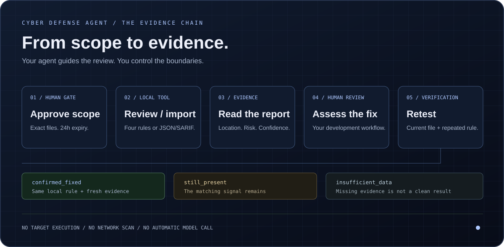
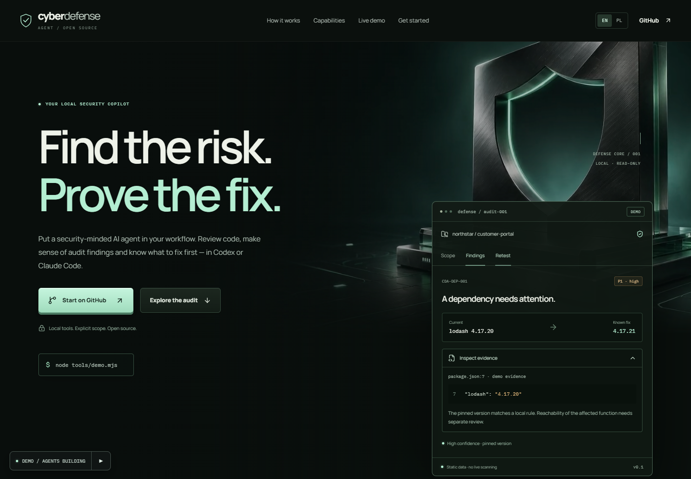

<p align="center">
  
</p>

<h1 align="center">Cyber Defense Agent</h1>
<p align="center"><strong>Give your AI agent a disciplined security workflow.</strong><br/>Find the risk. Understand the evidence. Verify the fix.</p>

<p align="center">
  <a href="https://aievolutionpl.github.io/cyber-defense-agent/"></a>
</p>
<p align="center">
  <a href="#start-in-one-minute">Quick start</a> ·
  <a href="examples/sample-audit.md">Example audit</a> ·
  <a href="skills/cyber-defense/SKILL.md">Read the skill</a> ·
  <a href="docs/VERIFICATION.md">Verification</a> ·
  <a href="https://aievolutionpl.github.io/cyber-defense-agent/pl/">Polski</a>
</p>

One inspectable skill for **Codex** and **Claude Code**, backed by local Node tools. It gives your coding agent a repeatable defensive process: ask the right questions, approve exact files, review evidence, explain the fix and retest conservatively. The website includes a guided, static-data presentation; it does not scan your machine.

> **For experienced AI-agent operators.** Use only resources you are authorized to assess. You control host permissions, data disclosure and applied changes. Provided as is, without warranty; not a security certification or a replacement for professional judgment. Read [responsible use](docs/RESPONSIBLE_USE.md) and [privacy & cookies](PRIVACY.md).

## How it works



1. **Orient:** a staged conversation establishes the goal, experience, desired outcome and data boundaries.
2. **Authorize:** approve the canonical root and exact files. No target content is read during the proposal.
3. **Inspect:** run four local rules or import supported JSON/SARIF. Review a Markdown report with location, redacted evidence, priority, confidence and suggested remediation.
4. **Decide:** assess the suggested fix in your normal development process. The tools do not change the target.
5. **Verify:** repeat the check. A confirmed fix needs fresh local evidence; missing data remains inconclusive.

The skill is the workflow; the CLI enforces file access and validates reports; the human controls permissions and changes. [Architecture and trust boundaries](docs/ARCHITECTURE.md).

## See it before you run it

[](https://aievolutionpl.github.io/cyber-defense-agent/)

The [interactive presentation](https://aievolutionpl.github.io/cyber-defense-agent/) walks through one synthetic dependency finding, the blocked out-of-scope action, its remediation and a retest. English by default, Polish available, with keyboard navigation, reduced motion and an optional agent-cursor build effect. Website buttons never grant access to your local files.

## Start in one minute

**Node.js 22+ and Git.** The local CLI has no npm dependencies. No provider account or paid model call is needed for the demo.

```sh
git clone --branch codex/node-v0.1 https://github.com/aievolutionpl/cyber-defense-agent.git
cd cyber-defense-agent
node tools/demo.mjs
```

For a guided terminal introduction:

```sh
node tools/cda.mjs start
```

```text
+-----------------------------------------+
| CYBER DEFENSE AGENT / OPERATOR INTAKE    |
| Local tools. Explicit scope. Evidence.  |
+-----------------------------------------+
01 / YOUR WORKSPACE  → experience & authorization
02 / YOUR GOAL       → files, report or lab planning
03 / YOUR OUTCOME    → review, prioritise or retest
04 / YOUR DATA       → local-only or ask before sharing
                       ↓
                A concrete next-step plan
```

The intake does not save answers, approve a scope, read a target or call a model. Type `q` to leave. In a noninteractive host, the skill conducts the same staged conversation directly.

## Platform and host support

| Environment | What is supported | Evidence |
|---|---|---|
| Windows / PowerShell | Node CLI, synthetic demo and static-site build | Local checks plus the CI matrix |
| Linux | Same Node CLI and site | Ubuntu Node 22 CI |
| macOS | Same Node CLI and site | macOS Node 22 CI; see latest run below |
| Codex | Thin skill entry → shared instructions | Contract verified; full model session **unverified** |
| Claude Code | Thin skill entry → shared instructions | Contract verified; full model session **unverified** |
| Hermes | Experimental thin entry | Discovery and full session **unverified** |

[Latest platform checks](https://github.com/aievolutionpl/cyber-defense-agent/actions/workflows/node-v01-check.yml) · [Exact results and limitations](docs/VERIFICATION.md). A passing local tool test is not proof of an authenticated model-host session. Node commands work in PowerShell, Bash and zsh; quote absolute paths containing spaces. OS isolation and permission configuration belong to your host and operating system.

## What works

- Exact file allowlist, separate approval, 24-hour expiry and revocation.
- Canonical directory and file/link guards; no project code execution, dependency installation or network calls.
- Four small local rules: pinned affected lodash, disabled TLS verification, possible quoted secrets and `eval`. This is not a full SAST engine or live advisory feed.
- `cda.scan.v1` JSON and a bounded subset of SARIF 2.1.0; validated local locations, deduplication and no imported free-form instructions in generated reports.
- Markdown findings with location, redacted evidence, priority, confidence and suggested fix.
- Conservative `confirmed_fixed`, `still_present`, `insufficient_data` retest results. Missing imported findings are not proof of a fix.
- Filename-based onboarding from the approved file list and a bounded, data-only `cda.model-input.v1` summary (no model API).
- Dark EN/PL site with synthetic report, defense overview, onboarding, full audit demo and an original reusable agent-cursor scroll effect.

Active web/API/network audits, IOC enrichment, model routing, MCP connectors, incident graphs and automatic response are [planned](docs/ROADMAP.md), not shipped capabilities. The current [architecture](docs/ARCHITECTURE.md) separates working controls from future adapters.

## Inspect the demo outputs

The demo copies known synthetic files into a new temporary directory. It changes only that copy, never executes fixture code and writes:

- `.cda/reports/demo-before.md`: lodash 4.17.20, `CDA-DEP-001`.
- `.cda/reports/demo-import.md`: safe metadata from a SARIF fixture.
- `.cda/reports/demo-retest.md`: live local-rule confirmation after changing the copy to 4.17.21.
- `.cda/reports/demo-no-data.md`: incomplete import → `insufficient_data`.

An attempted `../private/.env` read is blocked. The synthetic scratch directory stays available for inspection. Local reports/state are excluded from Git.

```sh
node tools/cda.mjs onboarding --scope demo
node tools/cda.mjs summary --scope demo --report demo-before --name model-summary
```

The summary writes local JSON; it sends nothing to a model. Review it before sharing. Opaque references need the original report locally.

## Codex

Install and sign in using the [official quickstart](https://developers.openai.com/codex/quickstart). Open the cloned trusted repository in the Codex app, or from its root run:

```sh
codex
```

Then ask:

```text
$cyber-defense demo
```

[Entry point](.agents/skills/cyber-defense/SKILL.md) → [canonical instruction](skills/cyber-defense/SKILL.md). No global defense-skill installation is needed. Invoke it explicitly for an audit. The local tools are verified separately from the host/model session; see [verification](docs/VERIFICATION.md).

## Claude Code

Install and authenticate using the [official quickstart](https://code.claude.com/docs/en/quickstart). From the trusted repository root run:

```sh
claude
```

Then ask:

```text
/cyber-defense demo
```

[Entry point](.claude/skills/cyber-defense/SKILL.md) loads the same canonical instruction. Model access is your separate provider service. An end-to-end authenticated model session is not established by a passing CLI test.

For your next conversation, use the [copy-ready prompts](skills/cyber-defense/references/prompt-recipes.md) for a local review, report import, retest or isolated-lab plan. The agent asks only what is missing, explains the next step and waits at real scope and data-sharing boundaries.

## Hermes (experimental)

[The thin Hermes entry](.hermes/skills/cyber-defense/SKILL.md) points to the same instruction. Automatic skill discovery, its installation path and an end-to-end model session are **unverified**. Open this trusted repository in your configured Hermes environment and explicitly ask it to read `skills/cyber-defense/SKILL.md` and follow only the bundled demo. No guessed installation command or automatic network action is provided.

## Your first own audit

Keep the trusted agent tools **outside** the reviewed project. Use a stable copy of the target. Specify exact relative files that you are authorized to inspect; the tool does not enumerate a target to guess its scope.

```sh
node tools/cda.mjs scope --root /path/to/project --allow package.json --allow src/config.ts --name audit
```

Review the canonical root and returned file list. Only after explicit approval of that exact proposal:

```sh
node tools/cda.mjs approve --scope audit --root /path/to/project --yes
node tools/cda.mjs show --scope audit
node tools/cda.mjs onboarding --scope audit
node tools/cda.mjs review --scope audit --name before
node tools/cda.mjs summary --scope audit --report before --name model-summary
```

Review `.cda/reports/before.md` and any summary locally before sharing with a model. Remediate in your normal workflow, then:

```sh
node tools/cda.mjs review --scope audit --name after
node tools/cda.mjs retest --scope audit --before before --after after --name retest
node tools/cda.mjs revoke --scope audit
```

For imports, approve the report itself and each referenced local source file. Example using synthetic files:

```sh
node tools/cda.mjs scope --root examples/demo-repo --allow package.json --allow reports/before.sarif --name imported
node tools/cda.mjs approve --scope imported --root examples/demo-repo --yes
node tools/cda.mjs import --scope imported --input reports/before.sarif --name imported-before
```

A denied read or unsupported format does not authorize another reader or an expanded scope. [Supported formats](docs/FORMATS.md).

## Data flow and limits

| Layer | Data processed | Provider/network exposure |
|---|---|---|
| Local CLI | Approved files and private `.cda/` state | No network, LLM SDK or telemetry |
| Importer | JSON/SARIF and scoped locations | Does not fetch URLs; omits imported free text, snippets and fixes |
| Model summary | Up to 100 facts, validated enums, opaque file/rule references | Local JSON only; no provider call |
| Codex / Claude / Hermes host | Prompt, tool output and content included in chat | May reach the host's model provider according to its settings |
| Public site | Static assets and synthetic interaction state | Hosting receives page requests; no code/domain uploads, analytics or model connection |

Redaction is heuristic and cannot detect every secret. Filenames can be sensitive. Instructions and tags do not provide OS isolation or guaranteed prompt-injection prevention. For hostile targets use independent OS-level containment. [Threat model](docs/THREAT_MODEL.md).

## Reuse the agent-build effect

The separate [agent-build-scroll skill](skills/agent-build-scroll/SKILL.md) ships original React/CSS assets and repo entry points for Codex and Claude. Invoke `$agent-build-scroll` or `/agent-build-scroll` to add staged cursor choreography to another page. Copy the skill folder to your host's documented user-skill location if needed. It has no browser-extension or paid service dependency. Reduced motion, pause, touch mode and a readable no-JS fallback are part of its contract.

`DhvanilPatel/swarm-cursors` is an inspiration link only. Its code was not copied. [Asset/motion provenance](motion/README.md).

## Develop the site

```sh
npm ci
npm run dev
# http://localhost:3107
npm run check
npm run demo
```

Next.js 16 / React / TypeScript / Tailwind 4. Static routes: `/` (English) and `/pl/` (Polish), each with a matching document language. `SITE_BASE_PATH` and `NEXT_PUBLIC_SITE_URL` configure static hosting; `npm run build` exports to `apps/site/out/`. All repository links derive from `apps/site/lib/config.ts`.

Browser acceptance uses `scripts/ui-acceptance.js` with the existing Playwright CLI. See exact commands and results in [VERIFICATION.md](docs/VERIFICATION.md). A desktop viewport is not a physical phone test.

```text
apps/site/                      EN/PL site, static interactive demos
skills/cyber-defense/           canonical defense workflow + references
skills/agent-build-scroll/      reusable original motion workflow + assets
.agents/ .claude/ .hermes/      thin host entry points
tools/                          local Node CLI, guards, parsers, summary
schemas/                        model input contract
examples/                       synthetic source, SARIF and sample audit
tests/                          scope, import, retest and triage checks
docs/                           architecture, research, integration, verification
motion/                         direction, IR, source graphic and provenance
```

First-party code: [MIT](LICENSE). Research includes [curated external repositories](docs/RESEARCH.md) for defensive methodology and authorized labs; they are not automatically installed, executed or relicensed here.

## Trust, maintenance and contribution

All first-party tools, prompts, examples, site source and tests are public. There is no network client, model SDK, telemetry or target-code executor in the audit CLI. Dependencies for the site are pinned in the lockfile. Inspect source and history; public code does not guarantee the absence of defects or supply-chain risk. [Security policy](SECURITY.md) · [Threat model](docs/THREAT_MODEL.md) · [Responsible use](docs/RESPONSIBLE_USE.md).

To contribute, use a branch and pull request, keep target reads behind `ScopedReader`, add meaningful regression tests for changed trust boundaries, and run `npm run check` plus `npm run demo`. Never attach private `.cda/` state or real secrets. Skill changes belong in the canonical folder; entry points remain thin. See [AGENTS.md](AGENTS.md) for engineering guidance and [CLAUDE.md](CLAUDE.md) for the Claude entry.

The site has no application cookies or analytics. Hosting still receives normal requests. The CLI is local; content placed in an AI-host conversation may reach that host's provider. [Privacy & cookies](PRIVACY.md).
