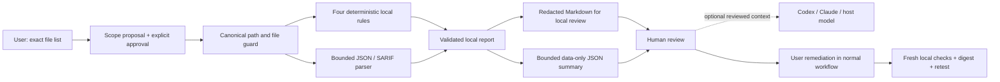

# Architecture: evidence first, authority outside the model

## Working v0.1 pipeline

The CLI itself has no LLM/provider SDK, network transport, telemetry, target code execution or remediation capability. The model cannot turn a scanner message into an executable action. The host still has its own tools and permissions; these scripts do not sandbox the host.

| OODA step | Implemented | Limits |
|---|---|---|
| Observe | Exact allowlist, local rules, bounded offline JSON/SARIF parser | No live telemetry, packet capture, SIEM or EDR |
| Orient | Validated enums/locations, deduplication, Markdown, `summary` JSON | No runtime exploitability analysis or event correlation |
| Decide | Human-reviewed priorities and proposed fixes; optional host-model explanation | No provider selection or automatic authorization |
| Act | Write local reports; repeat local checks after user remediation | No firewall, host, process, IAM or production changes |

## Structured model input (implemented)

`node tools/cda.mjs summary --scope audit --report before --name model-summary` writes `cda.model-input.v1` under `.cda/reports/`. It validates the report against the current approved scope, sorts by severity, caps facts at 100 and reports the omitted count. All target paths become opaque `file_###` references. Only the four known local rule identifiers survive; external identifiers become `external` plus an opaque `rule_###`. It recomputes priority from severity and copies no imported title, message, snippet, fix, URL, credentials or free-form filename. See [schema](../schemas/cda.model-input.v1.schema.json).

This is deterministic reduction, not an LLM alert classifier. It deliberately loses context; resolving opaque references needs the original report locally. The user reviews the summary before adding it to a model conversation. No content is sent automatically, and output size bounds are not a provider-specific token guarantee.

## Indirect prompt injection

Target files, headers, logs, scanner results, rule identifiers and filenames are adversarial data. The importer discards free-form text rather than asking the model to obey delimiters. The summary removes arbitrary rule identifiers and paths as an additional boundary. Markdown escaping and tags are formatting/defense-in-depth; neither proves immunity to injection. An instruction in a report cannot approve a scope, change policy, suppress a signal or invoke a tool.

Keep system instructions separate from facts in any future provider adapter. Validate both the input schema and model output. Proposed decisions may cite only known finding references and allowlisted action types. Treat malformed, unavailable or contradictory model output as a request for human review. Preserve deterministic evidence even when a model disagrees. Never let a model grant itself permissions.

## Model routing (planned, no provider calls in v0.1)

Use a provider-neutral adapter around request/response schemas. Consider a local/small model for limited classification or IOC extraction, and a frontier model only for an explicitly approved deeper correlation task. Ollama and LiteLLM are candidates, not installed integrations or endorsed default services.

The router must consider data classification, allowed providers, context budget, latency, quota and task type. A remote fallback needs prior data-sharing authorization; it must not silently transmit private logs after a local model fails. Return structured output, source references and uncertainty. Apply response validation, timeouts, bounded retries, cost limits and a circuit breaker outside the model. Model confidence alone is not permission to remediate.

Sigma/YARA or existing scanner adapters belong in the deterministic Observe layer, with pinned versions, bounded resources and independent tests. They are not bundled or run in this release. Do not promise that generic SARIF import automatically supports every tool/exporter.

Candidate upstream projects (metadata rechecked through GitHub REST; [snapshot](platform-research-sources.json)):

| Project | Potential role | Boundary |
|---|---|---|
| [SigmaHQ/sigma](https://github.com/SigmaHQ/sigma) | Structured log detection rules | Requires backend-specific conversion, field mapping and evaluation; rule content licensing needs review |
| [VirusTotal/yara](https://github.com/VirusTotal/yara) | Deterministic pattern matching of files/artifacts | Separate bounded runner; a match is not a malware verdict |
| [BerriAI/litellm](https://github.com/BerriAI/litellm) | Provider-neutral model adapter/proxy | Routing, credentials, telemetry, enterprise components and fallback data policies need independent review |
| [ollama/ollama](https://github.com/ollama/ollama) | Local model runtime candidate | Verify bind address, endpoint authentication, model licenses, resource limits and actual local operation |

These are additions to the defensive/lab [research catalog](RESEARCH.md), not dependencies or a claim of tested integrations.

## Risk classes and approval gates

| Class | Proposed examples | Required authority | Status |
|---|---|---|---|
| Local read | Approved files and offline reports | Exact root/list, expiry and revocation | Implemented |
| Tier 1: external read/enrichment | IOC reputation via VirusTotal, AbuseIPDB, Shodan | Explicit consent to transmit each data class, scoped credential, provider terms, budgets and egress allowlist | Planned |
| Tier 2: reversible defensive change | Time-limited rate limit or scanner block | Prior policy approval, protected infrastructure allowlist, TTL, rollback and independent authorization service | Planned; deny by default |
| Tier 3: disruptive/security authority change | Production host isolation, restart, IAM changes | Human approval of the exact reviewed action, target, reason, diff, expiry and rollback | Planned; no executor |

Read-only enrichment is not remediation and can leak sensitive indicators. “Obvious scanner” is not sufficient evidence for automated blocking. A firewall rule can cause self-DoS; simulate and review impact before any future rollout. A Slack/Telegram/dashboard button must carry an authenticated, one-use action digest; sending a chat message alone is not authorization. No such messaging or approval integration is installed here.

## MCP boundaries (planned)

Expose parsers, scanners and SIEM/EDR connectors as separately scoped adapters when justified. MCP standardizes access; it does not supply authorization, network isolation or a trustworthy result. Each adapter needs a versioned schema, identity, read/write distinction, least-privilege credentials, target registry, quota, timeout, structured errors and an audit record. An independent gateway enforces scope and egress even if the model or MCP server is compromised. No MCP server is shipped or started by v0.1.

## Incident state and memory (planned)

Current `.cda/` stores scopes and local reports, not an incident graph. Future ephemeral sessions may correlate normalized events by time, host, principal, indicator and evidence digest; model-generated relations must remain hypotheses. Retain original provenance and distinguish ingestion time from event time.

Persistent memory needs opt-in, tenant isolation, retention/deletion, encryption/access controls, provenance and review. False-positive exceptions must be narrow, attributable, time-bounded and reversible; never suppress all future behavior because one administrator action was once approved. Do not store raw secrets or permanently learn from hostile log text. Evaluate lateral-movement correlation and suppression against held-out attack and legitimate activity sequences before advertising either capability.

## Verification boundary

Offline tests prove specific parser, scope, redaction, summary and retest properties on fixtures. They do not prove resistance to all prompt injection, agent expertise, production containment, scanner recall or model quality. End-to-end host/model integrations remain separately documented in [VERIFICATION.md](VERIFICATION.md).
